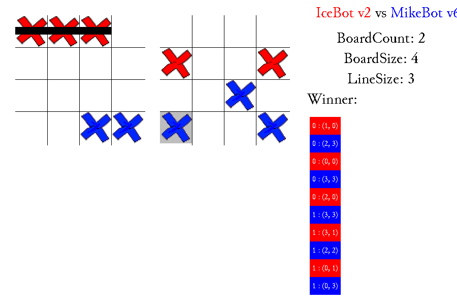

# nottt — No Tic Tac Toe

[](https://github.com/MJoergen/nottt/actions/workflows/ci.yml)

A C++ implementation of *No Tic Tac Toe* (also known as Notakto): a
misère variant of tic-tac-toe played on one or more boards, where both
players place the same mark (X). A board "dies" as soon as it contains a
complete line, and the player who kills the **last** live board loses.

The project contains:

* An SDL2 GUI for watching two bots play against each other.
* Several computer players ("bots"), including an alpha-beta searcher backed
  by endgame tablebases.
* A command-line tournament mode for pitting the bots against each other.
* Tools for generating endgame tablebases by retrograde analysis.



*A game on two 4×4 boards with line size 3. The crosses are coloured by the
bot that placed them (red: Ice, blue: MikeBot); the black line marks the
left board as dead, and the last move is highlighted in grey. The list on
the right shows the moves as board : (x, y).*

## Building

Dependencies: a C++11 compiler, SDL2, SDL2_image and SDL2_ttf (see
[Installing SDL2_image](#installing-sdl2_image) below).

Then:

```sh
make                # lists all targets
make all            # builds nottt, egtb and egtb-stats
make install        # installs in ~ (override with PREFIX=...)
```

`make install` copies the programs to `$(PREFIX)/bin`, and the assets and
tablebases to `$(PREFIX)/share/nottt`.

Setting `TARGET = windows` in the `Makefile` cross-compiles `nottt.exe` with
MinGW (`i686-w64-mingw32-g++`). The tablebase tools use `mmap` and are only
built on Linux.

### Installing SDL2_image

The GUI loads its PNG images with SDL2_image, so the development package
(headers and library) must be installed. If it is missing, the build fails
with `fatal error: SDL_image.h: No such file or directory`.

It is normally installed together with SDL2 and SDL2_ttf:

| Platform | Command |
|----------|---------|
| Debian / Ubuntu | `sudo apt install build-essential libsdl2-dev libsdl2-image-dev libsdl2-ttf-dev` |
| Fedora | `sudo dnf install gcc-c++ make SDL2-devel SDL2_image-devel SDL2_ttf-devel` |
| Arch Linux | `sudo pacman -S base-devel sdl2 sdl2_image sdl2_ttf` |
| macOS (Homebrew) | `brew install sdl2 sdl2_image sdl2_ttf` |

To check that it is installed:

```sh
pkg-config --modversion SDL2_image
```

The `Makefile` looks for the headers in `/usr/include/SDL2`. Elsewhere (e.g.
Homebrew installs them under `$(brew --prefix)/include/SDL2`), change
`INCLUDE_DIRS` and `LIB_DIRS` to point at your SDL2 install;
`pkg-config --cflags --libs SDL2_image` prints the right flags.

For the Windows cross-compile, download the MinGW development archives
(`SDL2-devel-*-mingw`, `SDL2_image-devel-*-mingw` and `SDL2_ttf-devel-*-mingw`)
from the [SDL2](https://github.com/libsdl-org/SDL/releases),
[SDL2_image](https://github.com/libsdl-org/SDL_image/releases) and
[SDL2_ttf](https://github.com/libsdl-org/SDL_ttf/releases) release pages, and
copy the contents of each archive's `i686-w64-mingw32` directory into
`/opt/i686-w64-mingw32`, which is where the `Makefile` expects them.

## Running

The program can be run from any directory. It looks for its assets
(`assets/`) and tablebases (`tables/`) next to the executable, as in the
repository, and then in `../share/nottt/` relative to it, as installed by
`make install`.

### GUI

```sh
nottt
```

The GUI shows a game between the Ice bot and MikeBot v6; a human cannot
play. Choose **New Game** in the main menu and set:

* **Board Count**, **Board Size** and **Line Size**: the game setup.
* **Game Seed**: the random seed, so a game can be replayed exactly.
* **Manual Mode**: step through the game yourself instead of watching it
  play automatically (one move per second). Press → to play the next move
  and ← to take back the last one.
* **Write log** and **Log Name**: save the moves to `<name>` in the user's log
  directory, which is created if needed: `~/.local/share/nottt/logs/` on Linux
  and `%APPDATA%\nottt\logs\` on Windows. The name may only contain letters,
  digits, `.`, `_` and `-`, and must not start with `.`.

Which bot moves first follows the bots' own choice, or is decided by the seed
when both want the same. After the last move, the winner is shown for a few
seconds (in manual mode, until → is pressed) before the program returns to
the main menu.

The **Bots** screen lists the available bots. **Load Game** and
**Statistics** are not implemented yet and show an empty screen.

### Bot tournament

```sh
nottt <boardCount> <boardSize> <lineSize> <numRounds> [logFile]
```

Plays a round robin between all bots (Mike v1–v6 and Ice) on
`boardCount` boards of size `boardSize`×`boardSize`, where `lineSize` marks
in a row kill a board. `boardSize` can be 1–8, and `lineSize` 1–`boardSize`
(the GUI also allows at most 25 boards). Results are printed after each round; if `logFile`
is given, every game is traced to it. `tools/stats.sh` runs a series of such
tournaments.

## Bots

| Bot | Source | Description |
|-----|--------|-------------|
| Mike v1–v6 | `src/NTTTPlayerMike.cpp` | Bitboard-based alpha-beta search. The version number selects the evaluation function; v6 is the newest, and caches its evaluation of each board. When only one board is alive it plays perfectly from the tablebase. |
| Ice | `src/NTTTPlayerIce.cpp` | Heuristic player. |

New bots derive from the abstract `NTTTPlayer` class (`src/NTTTPlayer.h`) and
implement `chooseOrder`, `chooseMove` and `getName`.

## Endgame tablebases

`egtb <boardSize> <lineSize>` solves every position on a single board by
retrograde analysis and writes `egtb-<boardSize>-<lineSize>.bit` to the
current directory, one bit per position (bit set = the side to move wins).
Board sizes 2–5 are supported. `tools/egtb.sh` regenerates all tablebases
from 2×2 to 5×5 in `tables/`, and `tables/egtb.log` holds the resulting
per-move-count statistics. `egtb-stats` reads a generated tablebase from the
current directory and prints further statistics.

Some results (see the comment at the top of `tools/egtb.cpp`):

* The empty 4×4 board (line length 3) is a win for the first player, but only
  when starting in a corner.
* The empty 5×5 board (line length 3) is a loss for the first player, no matter
  where they play.

## Repository layout

```
src/                        Game sources
  main.cpp                  Entry point: GUI or tournament mode
  NTTTGame.h                Game state: a set of boards
  DataPath.*                Finds the data files relative to the executable
  NTTTBoard.{h,cpp}         A single board and its alive/dead state
  NTTTMove.h                A move (board, x, y)
  NTTTPlayer.h              Abstract bot interface
  NTTTPlayerMike.*          Alpha-beta bot
  NTTTPlayerIce.*           Heuristic bot
  NTTTManager.*             SDL2 setup and main loop
  GUI/                      Widgets and screens
  trace.h                   Logging helper
tools/                      Tablebase tools and scripts
  egtb.cpp, egtb.sh         Tablebase generator
  egtb-stats.cpp            Tablebase statistics
  stats.sh                  Series of tournaments
  check-bots.sh             Compares the bots' games with tests/bots/
  check-tables.sh           Checks that egtb regenerates tables/
tests/bots/                 Reference games for check-bots.sh
.github/workflows/ci.yml    CI: style, -Werror build, and the two checks above
assets/                     Images and font used by the GUI
tables/                     Generated tablebases and their statistics
docs/                       Screenshot for this README
```

`make` builds into `build/` and puts the programs in the repository root.

## Known issues

See [TODO.md](TODO.md) for known bugs and planned improvements.

## License

The bundled Junicode font is distributed under the SIL Open Font License
(see `assets/SIL Open Font License.txt`).
